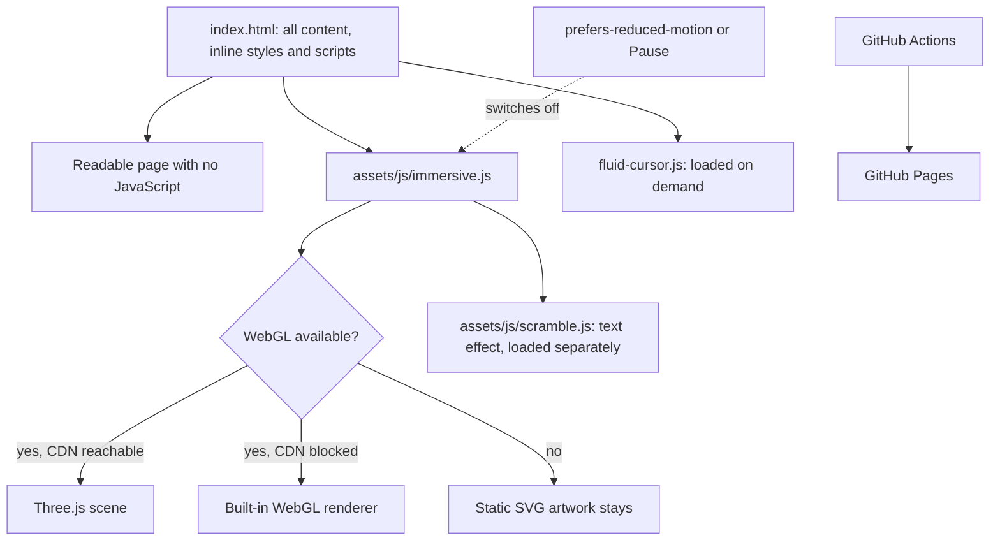

# the_raghav_raman

**A portfolio has to load fast and still work when scripts, WebGL or a CDN fail; this one is a single static page whose 3D layer is optional at every step.**

## Architecture



There is no build step, framework or backend.

## Quickstart

View it: [theraghavraman.github.io/the_raghav_raman](https://theraghavraman.github.io/the_raghav_raman/).

Run it locally with Python 3:

```bash
git clone https://github.com/theraghavraman/the_raghav_raman.git
```

```bash
python3 -m http.server 8000 --directory the_raghav_raman
```

Then open `http://localhost:8000`. Edit `index.html` and reload; pushing to `main` publishes the site.

---

Personal portfolio website and interactive experience.
